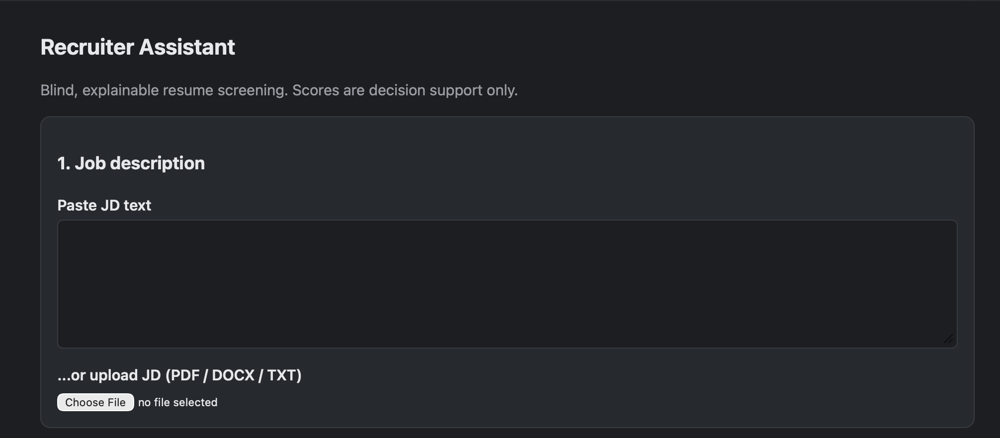
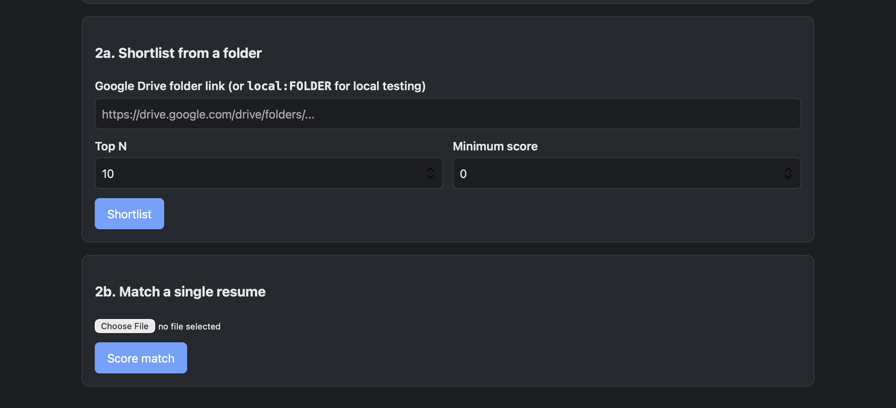
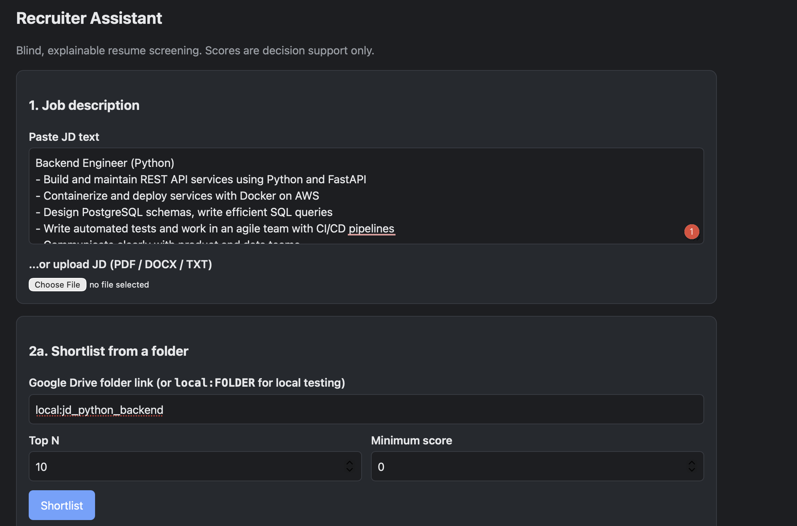
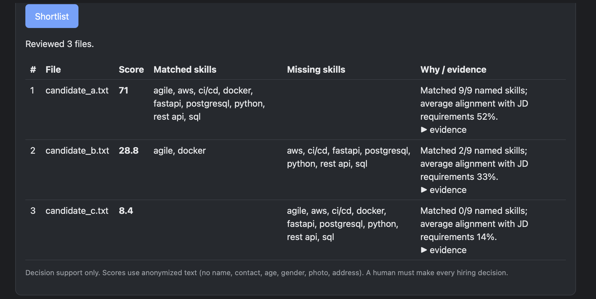
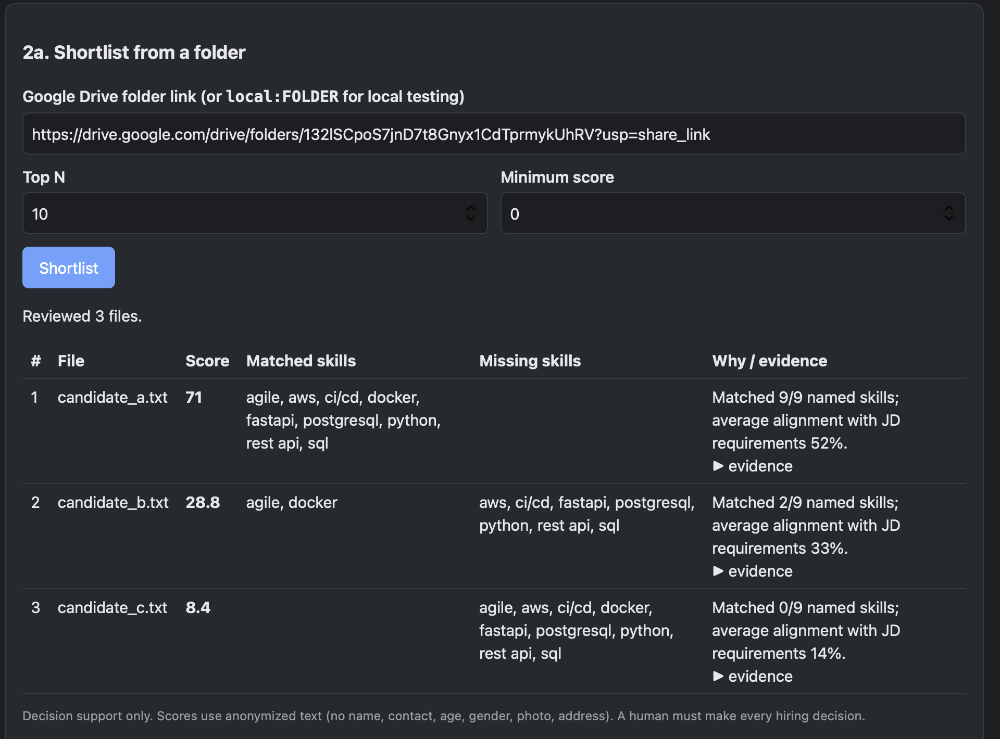
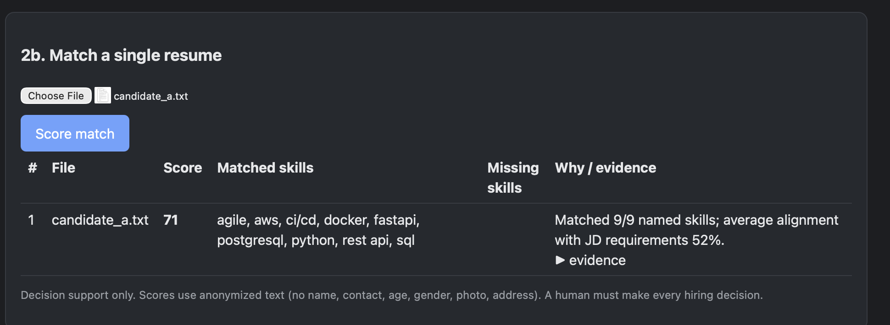
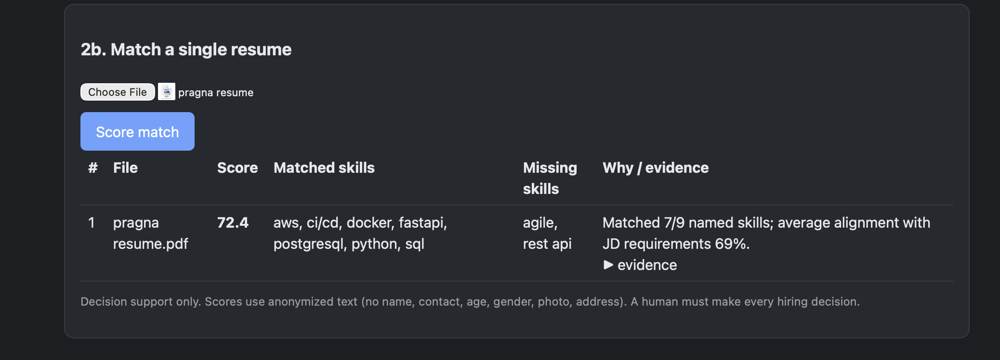

# Recruiter Assistant

A small agent that helps recruiters screen resumes against a job description (JD):

- **Match** one resume to a JD and get a 0-100 score.
- **Shortlist** a whole folder of resumes (Google Drive folder or local directory), ranked best first.

Every score comes with matched and missing skills and the resume excerpts behind it. Resumes are anonymized before scoring (name, contact details, age, gender, nationality, years), and results are decision support only: a human makes the hiring decision.

Built as a low-cost practice project: FastAPI, in-process embeddings, in-memory ChromaDB.
## Screenshots

| | |
|---|---|
| **JD input** <br>  | **Shortlist and single-resume inputs** <br>  |
| **Local shortlist setup** <br>  | **Local shortlist results** <br>  |

**Google Drive folder shared with the service account**



**Shortlist from the Drive folder**



**Single resume match**



## How it works

1. Parse PDF, DOCX or TXT (Google Docs are exported as text).
2. Anonymize the resume text (`app/anonymize.py`).
3. Split into chunks, embed them (fastembed, `bge-small-en-v1.5`) and store them in ChromaDB.
4. For each JD requirement line, retrieve the closest resume chunk.
5. Score = 60% semantic match + 40% coverage of the skills named in the JD.

The JD is also checked for biased wording (for example "young" or "native speaker").

## Quick start (local)

Requires Python 3.11+.

```bash
python -m venv .venv
source .venv/bin/activate          # Windows: .venv\Scripts\activate
pip install -r requirements.txt
cp .env.example .env
python -m pytest -q                # first run downloads the embedding model (~130 MB)
uvicorn app.main:app --reload --port 8000
```

Open http://localhost:8000, paste `sample_data/jd_python_backend.txt`, set the source to `local:jd_python_backend` and click **Shortlist**. Expected order: candidate_a, candidate_b, candidate_c.

Activate the venv in every new terminal, and restart `uvicorn` after editing `.env`.

## Google Drive setup

1. In Google Cloud, enable the **Google Drive API** and create a **service account**.
2. Service account page, **Keys** tab, **Add key**, **JSON**. Save it as `secrets/sa.json`.
3. Set `GOOGLE_APPLICATION_CREDENTIALS=./secrets/sa.json` in `.env`.
4. Share each resume folder with the service account's `client_email` as **Viewer**.
5. Paste the folder link in the UI.

The scope is read-only. Keep resumes directly in the folder (subfolders are not scanned).

## Docker

```bash
docker compose up --build          # http://localhost:8000
```

`docker-compose.yml` mounts `./resumes` and `./secrets` read-only into the container.

## Configuration

| Variable | Purpose | Default |
|---|---|---|
| `GOOGLE_APPLICATION_CREDENTIALS` | Path to the service-account key (local) | none |
| `GOOGLE_SERVICE_ACCOUNT_JSON` | Key contents as JSON (used on AWS, from SSM) | none |
| `RESUME_ROOT` | Base folder for `local:` sources | `./resumes` |
| `EMBED_MODEL` | fastembed model name | `BAAI/bge-small-en-v1.5` |

## API

| Endpoint | Purpose |
|---|---|
| `POST /api/match` | Form fields: `jd_text` or `jd_file`, `resume` (file) |
| `POST /api/shortlist` | Form fields: `jd_text` or `jd_file`, `source`, `top_n`, `min_score` |
| `GET /health` | Health check |

```bash
curl -F "jd_file=@sample_data/jd_python_backend.txt" \
     -F "source=local:jd_python_backend" http://localhost:8000/api/shortlist
```

## Project layout

```
app/            FastAPI app: main, parsing, anonymize, scoring, drive, static/index.html
tests/          pytest tests
resumes/        sample resumes (fake data only)
sample_data/    sample JD
infra/          AWS setup scripts and ECS task definition
.github/        CI/CD workflow (GitHub Actions to ECS)
```


## Limitations

- Anonymization is pattern-based and not perfect; embeddings can carry bias.
- The skill list in `app/scoring.py` favors tech roles; extend it for other roles.
- Scanned PDFs have no text layer and are skipped (no OCR).

